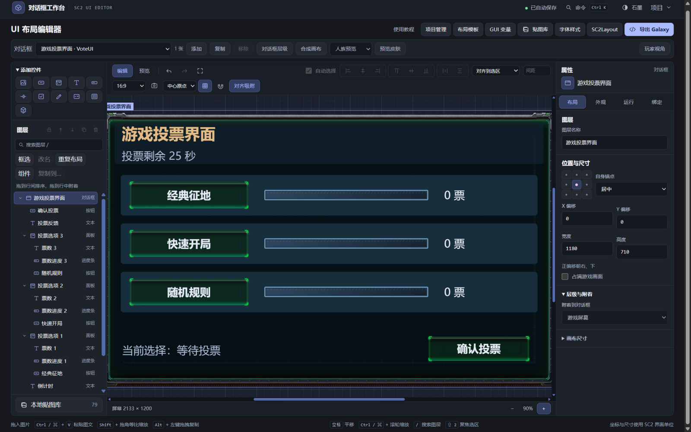
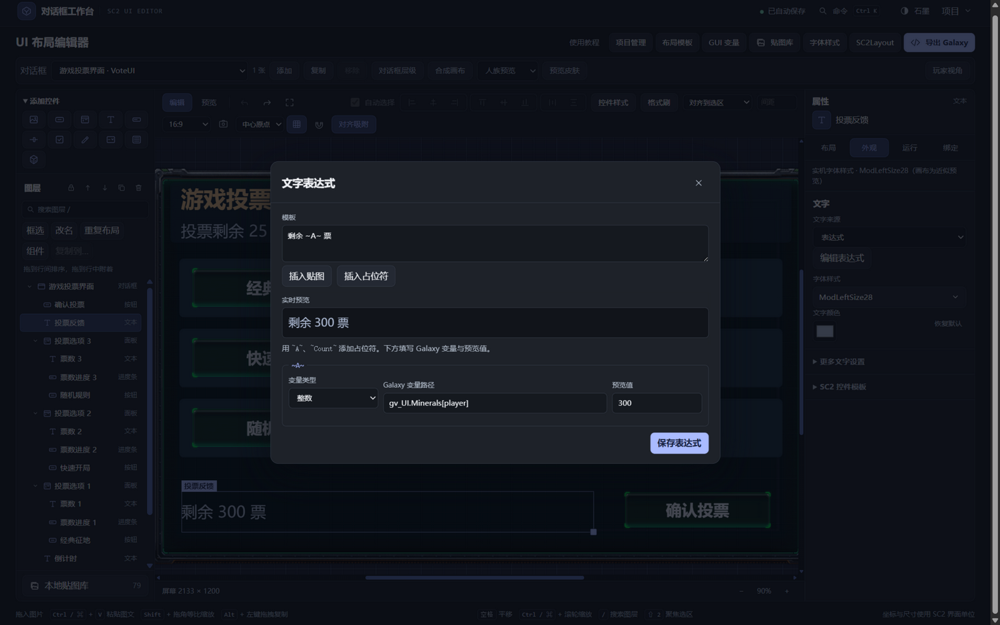
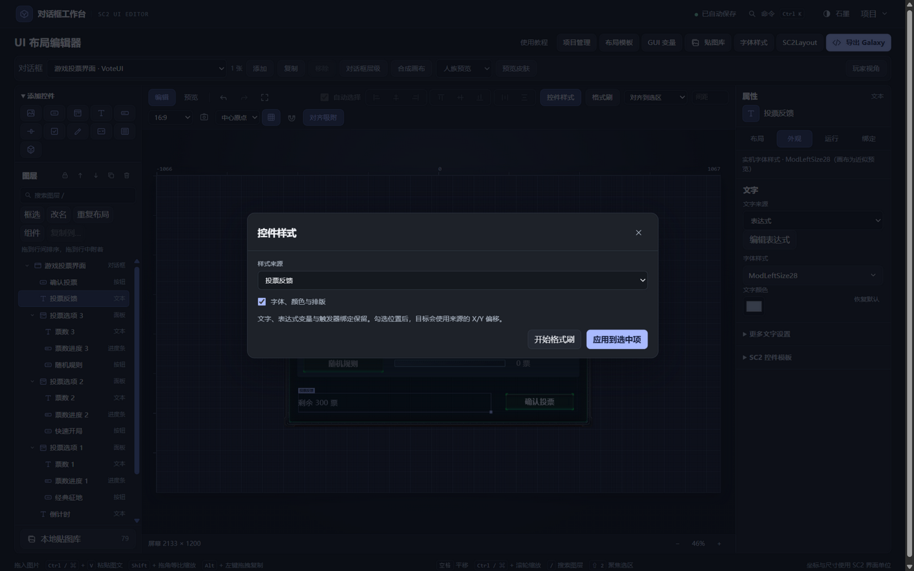
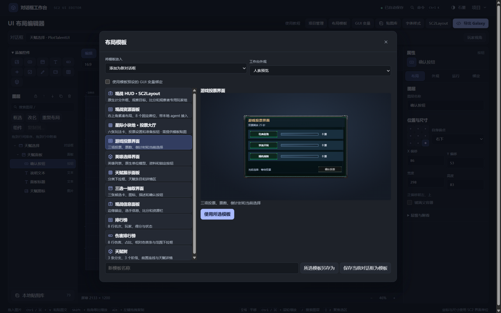
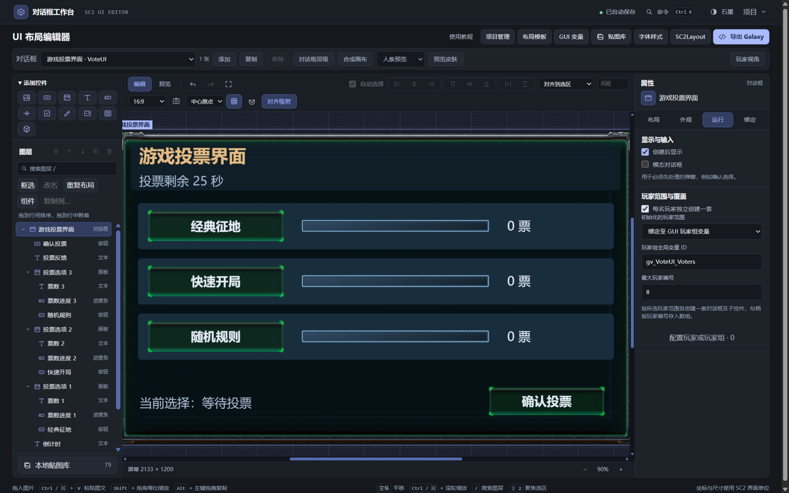
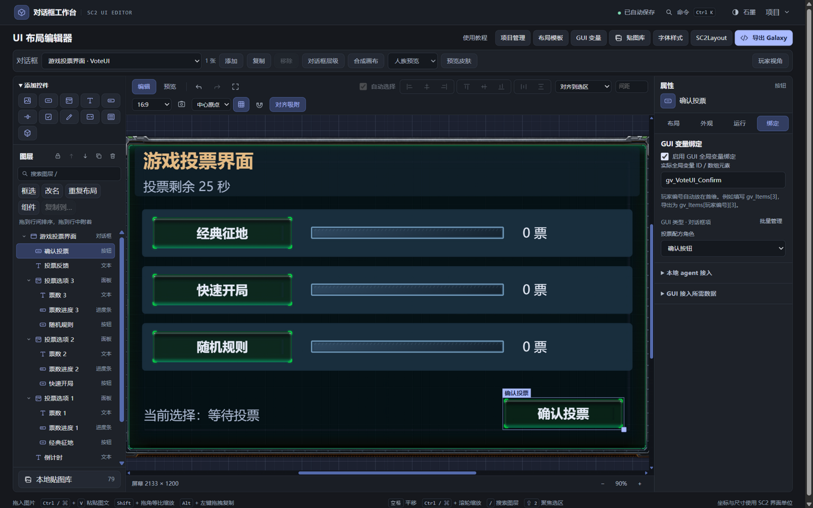
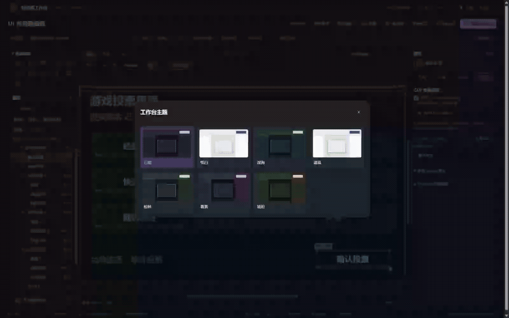

# SC2 UI 工作台

## v1.3.0 · 对话式协作技能

新增 `skills/sc2-workbench-collab` 技能：用户不再需要打开 PowerShell。把工作台目录交给本地 Agent，在对话里说「打开协作页」「加一个准备按钮」「给贴图打标」即可。Agent 会自行启动协作浏览器、打开项目 JSON、读取版本、提交编辑，并只在必须由用户决定时请求浏览器操作。

- `agent.mjs open 项目.json` 可由 Agent 直接打开项目，不再依赖网页文件选择。
- 用户只需要做两类浏览器操作：首次选择项目/地图/素材目录，以及最后确认定稿。
- Agent 不把命令、JSON、端口等细节推给用户；协作栏状态和画布就是进度界面。
- 普通实机预览仍使用启动器；协作页负责编辑、审批、增量回导和贴图标注。

技能目录：[skills/sc2-workbench-collab/SKILL.md](skills/sc2-workbench-collab/SKILL.md)

## v1.2.0 · Agent 打标与收藏优先

贴图库现在支持持久化分类、标签和收藏。Agent 可以分页查看已授权目录的缩略图，并按用途、种族、形态、名称和标签批量标注；你在贴图库右侧手动修改的字段优先保留，Agent 再次标注时会跳过这些字段并报告 `skipped`。

重新连接同一个授权目录后会恢复标注。标注、收藏和「Agent 优先用收藏」保存在浏览器配置中，跨项目可用；临时文件导入无法记住目录授权时，需要重新选择同一份素材。

点击预览下方的「收藏」可增减收藏，贴图库顶部可按收藏筛选。勾选「Agent 优先用收藏」后，Agent 搜索会先返回符合关键词和用途的收藏；指令明确要求只用收藏时，可传 `favorites: "only"`。

## v1.1.0 · 本地 Agent 协作

本版加入本地 Agent 协作标签页：在解压目录运行 `node agent.mjs start`，工作台会打开独立的协作浏览器配置，Agent 通过本机调试端口读写同一张画布。Agent 可以批量添加或修改控件、读取当前 `session` / `revision` / 选区、接收用户在画布上留下的「指出问题」，并在用户确认定稿后生成增量回导 ZIP。网页内的「暂停 Agent」「查看定稿」和确认按钮仍是最终审批入口。

配套工具：

- `agent.mjs`：启动协作标签页，提供 `get`、`status`、`edit`、`review`、`publish`、`claim`、`report` 命令。
- `apply_ui_revision.py`：核对定稿、目标地图、`MapScript.galaxy` 和文件哈希后，把增量回导包写入 `-UI-Test` 副本，失败回滚并保留备份。
- `Agent协作说明.md`：面向使用者和本地 Agent 的完整步骤、命令和编辑 JSON 示例。

协作模式只在 `index.html?agentCollab=1` 时显示协作栏；普通页面仍保留目标切换、中文名称、GUI 变量回导和实机预览。Agent 模式不会绕过目标确认，也不会自动修改正式地图；需要触发器接入时返回 `agentIntegration`，由本地 Agent 继续处理。

## v1.0.8 · 中文名称与地图变量回导

本版修复地图中文名称和变量编辑：读取组件地图的 `Triggers` 与 `TriggerStrings.txt`，对话框、控件和全局变量优先显示触发器里的中文名称；只有脚本名时才从 `gv_` 后的十六进制 UTF-8 字节解码，无法确认的 `Imported_N` 仍保留原描述。左侧「全局变量」默认显示所有已识别变量，变量编辑器的「类型」改为下拉选择（对话框、对话框项、整数、布尔值、实数等），已有地图变量保留原存储类型。

「项目 → 回导地图」现在可以生成能在银河编辑器 F6 中直接看到变量的地图副本：选择目标组件地图，选择「回导界面和变量」或「仅同步全局变量」，再选择保存目录。已有变量按触发器元素 ID 复用；启用 GUI 绑定的控件缺少变量时自动新建；数组长度、初始值和中文名称写入 `TriggerStrings`。复杂旧地图不能唯一确认替换范围时不会强行改写创建触发器，会提示改用变量同步副本，原触发器动作保留。

## v1.0.7 · 目标切换与冲突诊断

「实机预览」用游戏客户端检查对话框的布局、贴图和字体。开启「合成画布」时，导出并显示项目的全部对话框。关闭时，只导出并显示当前页。当前页附着于其它对话框时，会换算成等效的屏幕锚点和偏移。表达式取工作台的预览值，玩家覆盖取当前模拟玩家。

测试副本不再只能固定为上一次记住的地图：在「实机预览」里展开「更换测试副本」，填入另一个 `-UI-Test` 目录即可切换；每次切换都会生成新的修订号。写入前页面会再次核对目标，旧标签页或切换项目后残留的写入会被拒绝，避免把预览写到错误的地图。写入冲突会列出实际冲突文件和本次 `stage-report.json`；不会覆盖未确认的原文件。

启动器从 `map.txt` 读取上次目标，但只把它当作初始值；网页切换后会自动保存，不需要手动改文件。旧版启动器仍可使用新网页，只是会显示手动换图指引。

工作台启动器从 `ui_manifest.json` 的 `preview.sceneOverview` 读取合成画布状态，`preview.activeDialogId` 是当前页，`preview.dialogIds` 是本次导出并显示的对话框 ID，与 `dialogs` 一致。按 `files` 部署，脚本路径和引用见 `integration.script` 与 `integration.include`。切换范围时更新同一份预览脚本，下一局加载新范围。

### 首次连接测试地图

1. 在 Windows 上用银河编辑器把目标地图**另存为组件文件夹**，例如 `黄金矿工-UI-Test.SC2Map`。目录内应有 `ComponentList.SC2Components`，目录名的地图部分以 `-UI-Test` 结尾。请使用专门的测试副本名称，让启动器能识别编辑器当前窗口。
2. 双击工作台根目录的「启动SC2 UI 工作台.exe」，浏览器会自动打开 `http://127.0.0.1:8765/`。首次没有目标时，打开「实机预览 → 更换测试副本」，粘贴以 `-UI-Test` 结尾、包含 `ComponentList.SC2Components` 的完整目录路径，点「确认切换测试副本」，再勾选写入确认。之后会自动记住这个路径；换地图从同一入口切换即可。也可以从「项目管理 → 打开项目 JSON」载入项目。完整步骤见根目录的 `第一次使用.txt`。

   也可以在工作台目录用 PowerShell 运行源码方式（或双击 `tools\启动SC2 UI 工作台（备用）.bat`）：

   ```powershell
   py -3 .\tools\live_preview.py --map-copy 'D:\SC2\黄金矿工-UI-Test.SC2Map'
   ```

   exe 无窗口运行，浏览器就是界面：关闭工作台标签页后，本地服务会在几秒内自动退出并释放端口（浏览器异常退出时最多两分钟兜底）；再次双击会直接打开已有页面，不会重复启动。exe **每次请求都读取同目录的 `index.html`**：网页端更新 HTML 后刷新页面即可生效，不用重启或重新打包。`stage.py` 在启动时加载，替换后重启 exe 即可；`tools/live_preview.py` 或 `tools/launch_test_game.py` 是冻结代码，改动才需要重新打包（或改用备用 .bat 的源码方式）。如果双击时提示另一个工作台服务仍在运行，先关闭它的工作台标签页，约 10 秒后再启动。页面仍是 `index.html`，只是由启动器在 `127.0.0.1` 提供；直接以 `file://` 打开仍可编辑和导出，但不会显示「写入 / 启动」按钮。契约见 [docs/live-preview-baseline.md](docs/live-preview-baseline.md)。

3. 在工作台点「实机预览」，核对「实际写入的测试副本」，勾选「我确认上述测试副本是本项目此次预览的写入目标」，再点「写入并测试」。默认 `--launch direct`：启动器会写入预览脚本、自动补齐测试副本的 `include "Scripts/SC2WorkbenchPreview"` 和 `SC2WorkbenchPreview_Init();`，再用 `Support64\SC2Switcher_x64.exe -run "<测试地图路径>" -displaymode 0` 直接拉起游戏；如果该目标上一局仍由启动器记录并运行，会先尝试结束它。不需要银河编辑器，也不需要打包。页面里的「写入测试副本 / 写入并测试」只在启动器提供的 `127.0.0.1` 地址下出现。

4. 需要走银河编辑器的「测试文档」时，启动命令加 `--launch editor`：先把测试副本在编辑器中打开并保存，再点「写入并测试」，启动器会向该窗口发送测试命令。首次接入仍可用编辑器手动放置 `include "Scripts/SC2WorkbenchPreview"` 和 `SC2WorkbenchPreview_Init();`，或者让 direct 模式自动补齐后保存一次。

   「黄金矿工」组件副本已验证可用 `Support64\SC2Switcher_x64.exe -run "<测试地图路径>" -displaymode 0` 直启。

5. 需要把变量真正写进地图供 F6 触发器和后续玩法使用时，打开「项目 → 回导地图」。默认目标为当前已连接的原地图；也可点「选择目标地图」重新选择组件目录。选择「回导界面和变量」或「仅同步全局变量」，点「生成地图副本」并选择保存目录。生成的是新副本，不修改原图；已有全局变量按触发器元素 ID 复用，启用 GUI 绑定的控件缺少变量时才自动新建。复杂旧地图无法唯一确认原 UI 创建触发器时，会提示改用「仅同步全局变量」，不会吞掉原触发器动作。生成后用银河编辑器打开副本里的 `ComponentList.SC2Components` 并保存一次，按 F6 查看变量。

### 本地 Agent 协作

1. 在解压目录打开 PowerShell，运行 `node .\agent.mjs start`。需要 Node.js 22 或更新版本，并安装 Edge 或 Chrome；命令会打开自己的协作浏览器配置。
2. 在协作标签页打开项目 JSON 或导入组件地图，点击「恢复 Agent」。把解压目录交给本地 Agent，让它按 [Agent协作说明.md](Agent协作说明.md) 的 `get` / `edit` / `review` 流程操作。
3. 你可以在同一画布拖动、改属性或撤销；选中控件后「指出问题」会给 Agent 留言。Agent 提交定稿后，核对目标路径并「确认定稿并交给 Agent 回导」。
4. `publish` 会生成增量回导 ZIP；`claim` / `apply_ui_revision.py` 只对 `-UI-Test` 副本写入，写入前核对目标、脚本和文件哈希，失败回滚并保留备份。需要新建触发器或变量时，结果交给本地 Agent 的 `agentIntegration` 接入。

### 素材和写入状态

- 预览包生成自包含的 `Scripts/SC2WorkbenchPreview.galaxy`，负责创建和显示对话框、套用预览值。响应脚本、触发器、事件、动作函数及 GUI 变量由地图作者或本地 agent 另外接入。
- 在网页或离线 HTML 中可以直接下载预览包。需要读原地图的自定义贴图时，可先从正常的地图回导入口重新连接原素材目录。素材提示也可能列出由 SC2 依赖提供的路径。
- 启动器发现测试副本里的同名文件有外部变更时会报出冲突，并列出实际冲突路径和本次 `stage-report.json`；不会留下部分写入。首次确实要以项目内的字体样式覆盖副本字体时，可以给启动命令加 `--replace-font-styles`。旧文件、备份和每个测试副本的写入报告分别保存在本机 `SC2WorkbenchPreview` 状态目录，Windows 上通常位于 `%LOCALAPPDATA%`。

在浏览器里设计《星际争霸 II》对话框，所见即所得地摆放控件；支持文字表达式、控件样式和逐玩家实例，导出可直接接入银河编辑器的 Galaxy 布局、GUI 全局变量绑定和初始化动作。

[](https://github.com/spuperoldhen/sc2-ui-workbench/releases/latest)
[](LICENSE)
[](#快速开始)
[](#快速开始)



<p align="center"><sub>合成画布、图层树、属性面板与原生预览同屏。示例项目：游戏投票界面。</sub></p>

## 快速开始

1. **下载**：从 [Releases](https://github.com/spuperoldhen/sc2-ui-workbench/releases/latest) 下载最新发布包，解压后双击 `index.html`。
2. **打开**：使用桌面版 Chrome 或 Edge。无需安装，项目、贴图和字体都留在本机。
3. **开始**：跟随首次打开的上手引导，或从「布局模板」选择投票、英雄选择、排行榜等起点。
4. **导出**：从「导出 Galaxy」生成脚本、初始化动作、GUI 变量清单和地图回导 ZIP。

> 也可以把 `index.html` 放到任意静态站点。通过 `file://` 打开时，项目目录连接可能受限；需要本地目录管理时，建议在所在目录运行 `python -m http.server 8765 --bind 127.0.0.1`，再访问 `http://localhost:8765/`。

## v1.3.0 新增

| 功能 | 说明 |
| --- | --- |
| 对话式协作技能 | `sc2-workbench-collab` 让 Agent 自行启动协作页、打开项目和编辑 |
| 无需 PowerShell | 用户只在对话中提要求，Agent 在本机执行命令 |
| 直接打开项目 | `agent.mjs open 项目.json`，不再依赖网页文件选择 |
| 最小浏览器操作 | 只保留首次目录选择和最终定稿确认 |

## v1.2.0 新增

| 功能 | 说明 |
| --- | --- |
| 持久化贴图标注 | 用途、种族、形态、名称和标签保存到浏览器配置，重连授权目录后恢复 |
| 手动优先 | 用户手动保存的字段优先，Agent 批量标注会跳过并报告 `skipped` |
| 收藏与收藏优先 | 预览下方收藏；顶部「Agent 优先用收藏」让搜索先返回符合用途的收藏 |
| 只看收藏 | Agent 可用 `favorites: "only"` 只搜索收藏素材 |
| Agent 素材命令 | `asset-find`、`asset-preview`、`asset-tag`，支持已授权素材目录 |

## v1.1.0 新增

| 功能 | 说明 |
| --- | --- |
| Agent 协作标签页 | `node agent.mjs start` 打开独立浏览器配置，Agent 与用户共享同一张画布 |
| 会话与版本保护 | 每次提交核对 `session` / `revision`；用户编辑、暂停或进入定稿后旧请求失效 |
| 定稿审批 | 用户在画布内查看定稿摘要并确认，Agent 才能导出回导包 |
| 增量回导 | `apply_ui_revision.py` 核对目标、脚本和文件哈希，写入 `-UI-Test`，失败回滚并备份 |
| 问题留言 | 选中控件后「指出问题」，留言随控件编号交给 Agent |
| 全局变量命名与行为编辑 | 保留新版工作台的全局暴露、自动标识符、行为规则和结构体变量能力 |

## v1.0.8 新增

| 功能 | 说明 |
| --- | --- |
| 中文 GUI 名称 | 从 `Triggers` 和 `TriggerStrings.txt` 读取变量、对话框和控件名称；十六进制脚本名按 UTF-8 回退解码 |
| 变量类型下拉 | 对话框、对话框项、整数、布尔值、实数、字符串、玩家组等；已有地图变量保留存储类型 |
| 全部变量列表 | 左侧「全局变量」默认显示所有已识别变量，可按名称、类型和脚本标识符搜索 |
| 一键地图副本 | 「回导地图」选择目标地图和保存目录，生成带真实 GUI 全局变量的新副本 |
| 复用与新建 | 按触发器元素 ID 复用已有变量；启用 GUI 绑定的控件缺变量时自动新建 |
| 安全回导 | 复杂旧地图无法确认创建触发器时只做变量同步，保留原动作；不覆盖原地图 |

## v1.0.7 新增

| 功能 | 说明 |
| --- | --- |
| 测试目标切换 | 网页直接输入并切换到另一个 `-UI-Test` 副本，原子保存 `map.txt` |
| 修订号并发保护 | 写入/启动核对 `targetRevision`；旧标签页、切换项目或缺失修订号返回 409 |
| 冲突诊断 | 返回实际冲突文件、类型、SHA-256 与 `stage-report.json` 路径 |
| 按目标隔离 | 每个副本独立的 ownership、备份、报告和上一局 PID；不继承另一张地图的记录 |
| 宽松兼容 | 旧启动器 + 新网页显示手动换图指引；不调用未实现接口 |
| 网页 v1.0.7 | 目标确认、路径输入、来源地图名提示、写入诊断详情 |

## v1.0.6 新增

| 功能 | 说明 |
| --- | --- |
| 实机预览 | 从工作台写入测试副本并直启游戏，检查布局、贴图、字体和 HUD 遮挡 |
| 无窗口启动器 | `启动SC2 UI 工作台.exe` 双击即用；关页自动退出并释放端口 |
| 合成画布 / 当前页 | 画布开启预览全部对话框，关闭只预览当前页并换算锚点 |
| 直启测试副本 | 自动补 include/InitMap，调用 SC2Switcher 启动目录形态 `-UI-Test` 副本 |
| 本地基线 | `docs/live-preview-baseline.md` 与 `第一次使用.txt` |
| 顶栏分组 | 项目与布局 / 素材与接入 / 测试与导出三组，按钮带图标 |
| 教程章节 | 使用教程移到品牌旁，新增项目与模板、表达式与格式刷、实机预览三章 |
| 表达式预览 | 弹窗和画布共用字号、字重、颜色、对齐；40 高行内图按 34 显示 |
| 对话框背景 | 矮框保留原生边角，通过裁切适应高度 |
| 独立项目导入 | 打开项目 JSON 默认独立导入，原草稿可从项目管理切回 |

## v1.0.5 新增

| 功能 | 说明 |
| --- | --- |
| 文字表达式 | 文本与按钮可混排固定文字、行内贴图、富文本和变量占位符；支持结构体成员、数组和 `[player]` |
| 控件样式与格式刷 | 保存字体、颜色、贴图、位置、尺寸、锚点和表达式格式，批量应用或逐次点刷 |
| 项目管理 | 选择本地目录后，项目卡片以合成画布展示，支持打开、保存、另存、收藏、置顶、重命名、删除和大图预览 |
| 布局模板 | 先预览效果、切换三族外观，再添加或替换当前对话框；支持自定义模板和跨项目复制 |
| 逐玩家独立实例 | 为玩家组中的每名玩家创建独立对话框与子控件，句柄按游戏玩家编号保存 |
| 逐项 GUI 绑定 | 对话框和控件可单独启用 GUI 全局变量；玩家编号自动成为数组首维 |
| 结构体变量导入 | 从 Galaxy 脚本识别结构体成员、嵌套成员和静态数组索引；导入、初始化导出和回导清单保留完整路径 |
| 贴图库瀑布视图 | 缩略图 / 瀑布 / 列表三种视图，支持 50 / 100 / 200 / 全部分页和滚动加载 |
| 七套工作台主题 | 新增霜蓝、松林、暮紫和琥珀 |

完整说明见 [RELEASE_NOTES.md](RELEASE_NOTES.md)。

## 从设计到地图

| 步骤 | 做什么 | 工作台位置 |
| --- | --- | --- |
| 1. 布局 | 摆放控件、对齐、附着、核对参考截图和安全区 | 合成画布 / 布局模板 |
| 2. 绑定 | 设置玩家组、逐玩家覆盖、GUI 变量和 Agent 接入 | 运行 / 绑定 |
| 3. 导出 | 生成 Galaxy 脚本、初始化、变量清单和回导 ZIP | 导出 Galaxy |
| 4. 回导 | 由本地 Agent 写入测试地图并校验编译 | `$sc2-galaxy-bridge` |

## 文字表达式



<p align="center"><sub>模板可混排固定文字、行内贴图、富文本和 ~A~ 占位符，并实时预览。</sub></p>

- 文本控件和按钮的「外观 → 文字来源」可切换为「表达式」。
- 占位符支持整数、实数、字符串和文本，可读取地图变量、结构体成员和数组。
- 独立玩家实例使用 `[player]` 读取对应玩家，例如 `gv_UI.Minerals[player]`。
- 行内贴图可设置宽度、高度与纵向对齐，`align="middle"` 会导出为 `alignment="Middle"`。
- 地图变量更新后执行「刷新文字表达式」片段，即可重新读取并显示数值。

## 控件样式与格式刷



<p align="center"><sub>把字体、颜色、贴图、位置、尺寸、锚点和表达式格式保存为可复用样式。</sub></p>

- 选中来源控件，点击画布顶部的「格式刷」，再点击目标控件或图层；按 `Esc` 取消。
- 「控件样式」可勾选属性并保存整套样式，选中一个或多个目标后批量应用。
- 宽高、锚点、铺满和 SC2Layout 模板可单独勾选；只调整尺寸或锚点时，目标左上角保留原位。
- 「表达式格式与行内图尺寸」可复制行内图片的宽高与对齐，以及统一富文本样式。
- 目标保留自己的文字、本地化键、占位符、变量、图片路径和触发器绑定；应用可撤销。

## 项目管理


<p align="center"><sub>项目卡片直接显示合成画布，支持收藏、置顶、大图、重命名和跨项目复制。</sub></p>

- 选择一个本地目录，侧边栏会索引其中的 `.sc2ui.json`。
- 卡片直接显示合成画布；点「大图」放大检查。
- 点「保存当前」首次会引导选择本地目录并创建项目文件，之后更新已打开的文件。
- 卡片显示保存状态；项目可收藏、置顶、重命名或删除。删除前会确认，已保存项目会删除本地 JSON 文件。
- 地图回导的「重新连接地图文件夹」读入资源后会返回回导窗口；导入另一张地图会打开新项目，原草稿可从侧边栏切回。
- 在不同项目间复制整个对话框或所选控件，内嵌贴图和内部附着一起带上。

## 布局模板




- 内置投票、英雄选择、三选一、排行榜、伤害排行榜、天赋树、观战 HUD 等模板。
- 单击预览，切换人族 / 星灵 / 异虫外观比较。
- 可添加为新对话框，或替换当前对话框。
- 可把所选模板另存一份，也可把当前对话框保存为自定义模板。
- 可选启用模板预设的 GUI 绑定；粘贴到其他项目时默认关闭绑定。

## 每名玩家独立实例



<p align="center"><sub>在对话框的「运行 → 玩家范围与覆盖」中开启；最大玩家编号默认 8，索引 0 留空。</sub></p>

- 初始化遍历所选玩家组，为每名玩家创建独立的对话框和子控件。
- 句柄按游戏玩家编号保存在脚本数组；只向对应玩家显示。
- 适合准备状态、余额、排名、技能栏、个人商店等需要每人一份的界面。
- 玩家编号不连续时也按实际编号保存；子控件继承对话框的实例设置。

```galaxy
// 填写 gv_SkillButtons[3]
// 开启逐玩家实例后导出为：
gv_SkillButtons[EventPlayer()][3]
```

## GUI 全局变量绑定



<p align="center"><sub>对话框和控件可逐项启用；玩家编号自动放在数组首维。</sub></p>

- 对话框和控件逐项勾选「启用 GUI 全局变量绑定」。
- 新建项默认由生成的 Galaxy 脚本管理；旧项目已有绑定继续生效。
- 关闭绑定会保留填写过的变量名，便于再次启用。
- 玩家编号自动放在数组首维：填写 `gv_SkillButtons[3]`，导出为 `gv_SkillButtons[玩家编号][3]`。
- 「批量管理」可一次设置多个控件；「本地 agent 接入」可填写用途、事件、范围和验收说明，随 `ui_manifest.json` 导出。

## 结构体变量导入


<p align="center"><sub>粘贴地图脚本中的结构体与全局变量声明，逐层核对成员名称、类型和数组范围。</sub></p>

- 绑定输入支持结构体成员路径，例如 `gv_UI[2].Hud.Cards[1]`。
- 从生成的 Galaxy 脚本识别结构体成员、嵌套成员和静态数组索引。
- 文字表达式的占位符也可读取结构体成员、嵌套成员和静态数组索引。
- 导入、初始化导出和地图回导清单保留完整路径，例如：

```galaxy
gv_UI[2].Hud.Cards[PlayerGroupLoopCurrent()][1] = VoteUI_Button_18[PlayerGroupLoopCurrent()];
```

- 「导出 Galaxy → 地图变量核对」可载入地图脚本或直接粘贴声明，检查每一层的成员名称、类型和数组范围；缺少玩家维或数组范围不足会直接标出。
- 逐玩家实例会把玩家编号放在末级成员数组的首维；普通数组则放在原数组首维。

## 本地贴图库


<p align="center"><sub>瀑布视图、缩略图大小、比例和分页；右侧预览可换透明棋盘、深底或浅底。</sub></p>

- 接入本地图标浏览器目录、素材目录，或直接导入 DDS。
- 按中文用途、种族、文件名和 DDS 路径搜索。
- 缩略图 / 瀑布 / 列表三种视图；可调缩略图大小和原图、1:1、4:3、16:9 比例。
- 每页 50 / 100 / 200 / 全部；全部模式随滚动分批加载。
- 支持收藏、复制路径、下载 DDS 和添加到画布。
- 在同一浏览器与页面地址下自动恢复已授权的目录；浏览器要求确认时可点「授权恢复」。

配套图标浏览器：[sc2-ui-browser](https://github.com/spuperoldhen/sc2-ui-browser)

## 七套主题




石墨、纸白、深海、霜蓝、松林、暮紫、琥珀。顶部主题选择器可预览并切换，记住上次选择。

## 画布与编辑效率

- **合成画布**：同时显示所有对话框；点控件自动切到所属对话框。
- **多对话框**：对话框层级可拖拽排序，列表上方显示在前，导出使用该顺序。
- **对齐与分布**：左 / 中 / 右、顶 / 中 / 底对齐，水平和垂直等距；可用选区、最后选中控件或当前对话框作为参考。
- **拖入与粘贴**：拖入图片、粘贴截图或文本即可创建控件；图片随项目 JSON 保存。
- **参考截图**：载入游戏截图，调整透明度，检查 HUD 重叠和安全区。
- **三族预览**：人族、星灵、异虫原生图集预览；可切换预览皮肤。
- **字体样式**：从已有样式另存为新 ID，编辑粗体、阴影、斜体、光晕等标记。
- **导入与转换**：SC2Layout、SC2Components 导入，图片转 DDS，贴图回导 ZIP。
- **本地 Agent 接入**：投票、三选一、英雄选择、观战和天赋树的用途、事件与验收说明随清单导出。

## 快捷键

| 快捷键 | 操作 |
| --- | --- |
| `Ctrl / ⌘ + K` | 快速命令 |
| `/` | 搜索图层 |
| `Space` + 拖动 | 平移画布 |
| `Alt` + 左键拖拽 | 复制控件、面板或整张对话框 |
| `Shift` + 拖动右下角 | 等比缩放 |
| `Ctrl / ⌘` + 滚轮 | 以指针为中心缩放 |
| `Shift + 1` / `Shift + 2` | 适应画布 / 聚焦选区 |
| `Shift + F` | 画布专注模式 |

## 导出与本地 Agent

「导出 Galaxy」会生成：

- Galaxy 布局脚本与控件创建函数
- 地图初始化动作
- GUI 变量与数组长度清单
- 逐玩家实例的访问方式和玩家编号范围
- 贴图回导 ZIP（含 DDS 转换）
- 供本地 Agent 使用的 `ui_manifest.json`

Windows 本地 Agent 可载入 [`skills/sc2-galaxy-bridge`](skills/sc2-galaxy-bridge/SKILL.md)，读取项目 JSON，自动导出、写入测试地图副本、接入触发器并校验编译。详细步骤见 [Windows 操作手册](skills/sc2-galaxy-bridge/references/windows-editor.md)。

## 部署到静态站点

1. 解压发布包，把 `index.html`、`README.md` 和 `.nojekyll` 放到站点根目录。
2. GitHub Pages 选择 **Deploy from a branch** 和 **/ (root)**。
3. 部署完成后从 Pages 地址打开；项目数据保存在浏览器本地。

## 文档

- [更新日志](RELEASE_NOTES.md)
- [全局变量命名说明](使用说明.md)
- [Agent 协作说明](Agent协作说明.md)
- [Windows 本地 Agent 操作手册](skills/sc2-galaxy-bridge/references/windows-editor.md)
- [提交问题](https://github.com/spuperoldhen/sc2-ui-workbench/issues)
- [MIT License](LICENSE)

---

如果这个工具对你有帮助，欢迎点一个 Star。
