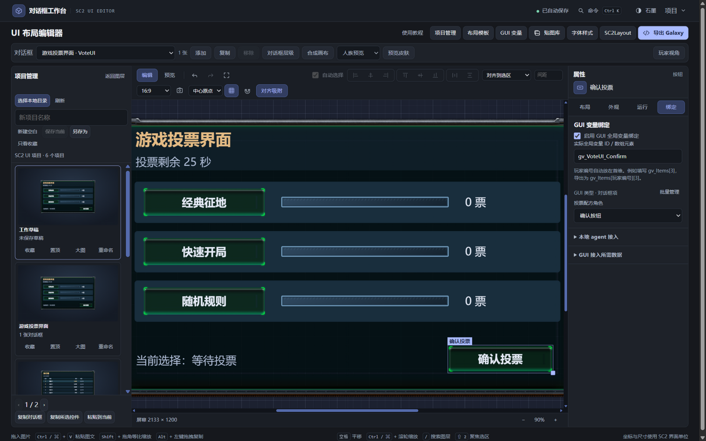
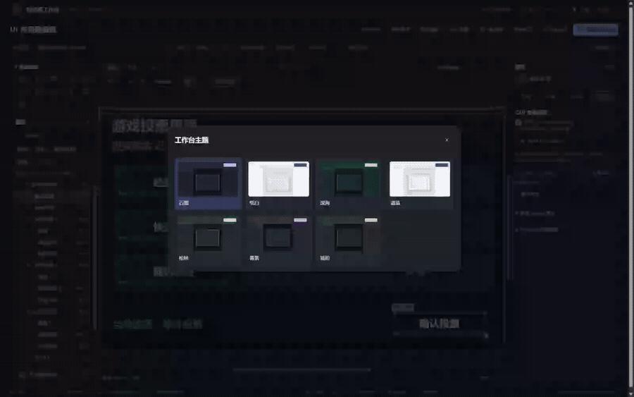
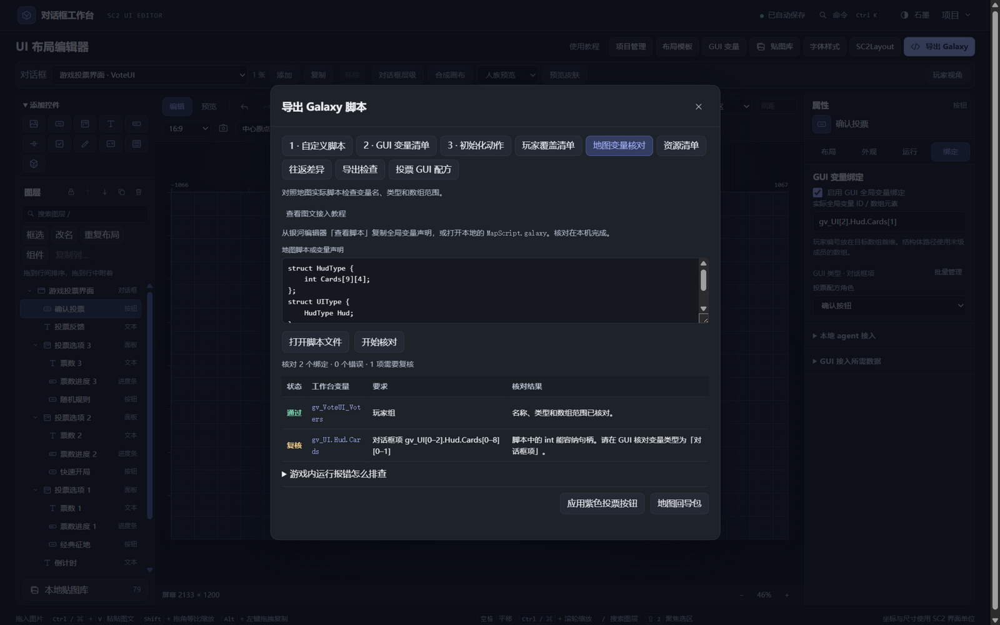
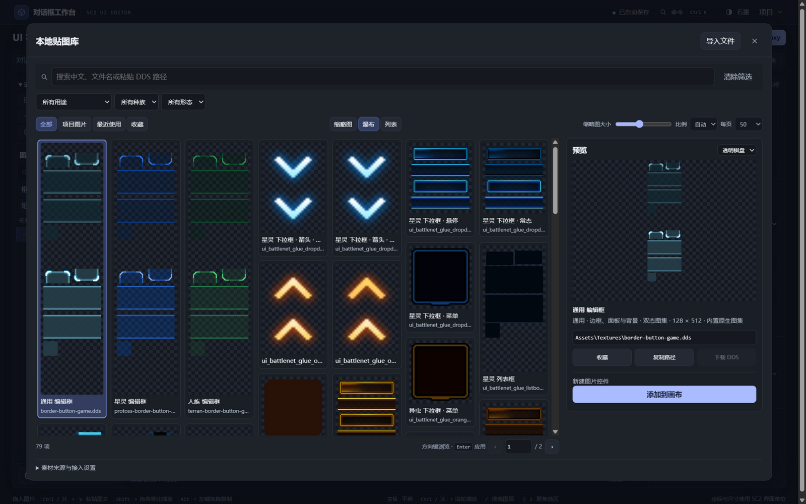
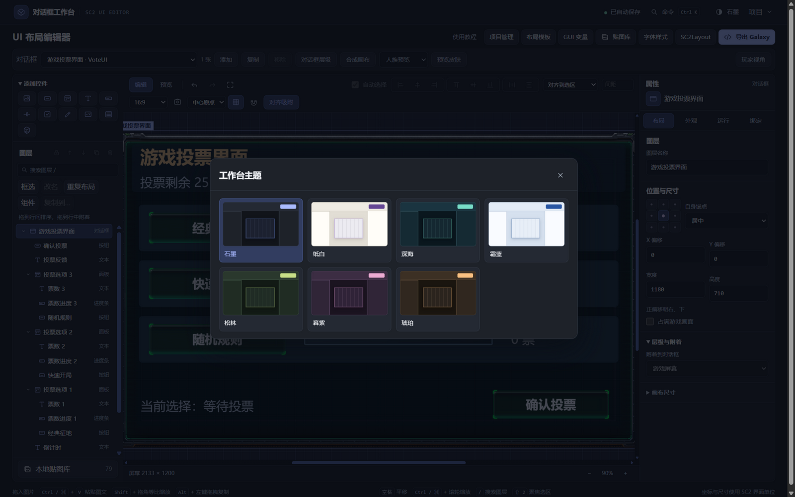

# SC2 UI 工作台

在浏览器里设计《星际争霸 II》对话框，所见即所得地摆放控件；支持文字表达式、控件样式和逐玩家实例，导出可直接接入银河编辑器的 Galaxy 布局、GUI 全局变量绑定和初始化动作。

[](https://github.com/spuperoldhen/sc2-ui-workbench/releases/latest)
[](LICENSE)
[](#快速开始)
[](#快速开始)


<p align="center"><sub>合成画布、图层树、属性面板与原生预览同屏。示例项目：游戏投票界面。</sub></p>

## 快速开始

1. **下载**：从 [Releases](https://github.com/spuperoldhen/sc2-ui-workbench/releases/latest) 下载最新发布包，解压后双击 `index.html`。
2. **打开**：使用桌面版 Chrome 或 Edge。无需安装，项目、贴图和字体都留在本机。
3. **开始**：跟随首次打开的上手引导，或从「布局模板」选择投票、英雄选择、排行榜等起点。
4. **导出**：从「导出 Galaxy」生成脚本、初始化动作、GUI 变量清单和地图回导 ZIP。

> 也可以把 `index.html` 放到任意静态站点。通过 `file://` 打开时，项目目录连接可能受限；需要本地目录管理时，建议在所在目录运行 `python -m http.server 8765 --bind 127.0.0.1`，再访问 `http://localhost:8765/`。

## v1.0.5 新增

| 功能 | 说明 |
| --- | --- |
| 文字表达式 | 文本与按钮可混排固定文字、行内贴图、富文本和变量占位符；支持结构体成员、数组和 `[player]` |
| 控件样式与格式刷 | 保存字体、颜色、贴图、位置、尺寸、锚点和表达式格式，批量应用或逐次点刷 |
| 项目管理 | 选择本地目录后，项目卡片以合成画布展示，支持打开、保存、另存、收藏、置顶、重命名、删除和大图预览 |
| 布局模板 | 先预览效果、切换三族外观，再添加或替换当前对话框；支持自定义模板和跨项目复制 |
| 逐玩家独立实例 | 为玩家组中的每名玩家创建独立对话框与子控件，句柄按游戏玩家编号保存 |
| 逐项 GUI 绑定 | 对话框和控件可单独启用 GUI 全局变量；玩家编号自动成为数组首维 |
| 结构体变量导入 | 从 Galaxy 脚本识别结构体成员、嵌套成员和静态数组索引；导入、初始化导出和回导清单保留完整路径 |
| 贴图库瀑布视图 | 缩略图 / 瀑布 / 列表三种视图，支持 50 / 100 / 200 / 全部分页和滚动加载 |
| 七套工作台主题 | 新增霜蓝、松林、暮紫和琥珀 |

完整说明见 [RELEASE_NOTES.md](RELEASE_NOTES.md)。

## 从设计到地图

| 步骤 | 做什么 | 工作台位置 |
| --- | --- | --- |
| 1. 布局 | 摆放控件、对齐、附着、核对参考截图和安全区 | 合成画布 / 布局模板 |
| 2. 绑定 | 设置玩家组、逐玩家覆盖、GUI 变量和 Agent 接入 | 运行 / 绑定 |
| 3. 导出 | 生成 Galaxy 脚本、初始化、变量清单和回导 ZIP | 导出 Galaxy |
| 4. 回导 | 由本地 Agent 写入测试地图并校验编译 | `$sc2-galaxy-bridge` |

## 文字表达式


<p align="center"><sub>模板可混排固定文字、行内贴图、富文本和 ~A~ 占位符，并实时预览。</sub></p>

- 文本控件和按钮的「外观 → 文字来源」可切换为「表达式」。
- 占位符支持整数、实数、字符串和文本，可读取地图变量、结构体成员和数组。
- 独立玩家实例使用 `[player]` 读取对应玩家，例如 `gv_UI.Minerals[player]`。
- 行内贴图可设置宽度、高度与纵向对齐，`align="middle"` 会导出为 `alignment="Middle"`。
- 地图变量更新后执行「刷新文字表达式」片段，即可重新读取并显示数值。

## 控件样式与格式刷


<p align="center"><sub>把字体、颜色、贴图、位置、尺寸、锚点和表达式格式保存为可复用样式。</sub></p>

- 选中来源控件，点击画布顶部的「格式刷」，再点击目标控件或图层；按 `Esc` 取消。
- 「控件样式」可勾选属性并保存整套样式，选中一个或多个目标后批量应用。
- 宽高、锚点、铺满和 SC2Layout 模板可单独勾选；只调整尺寸或锚点时，目标左上角保留原位。
- 「表达式格式与行内图尺寸」可复制行内图片的宽高与对齐，以及统一富文本样式。
- 目标保留自己的文字、本地化键、占位符、变量、图片路径和触发器绑定；应用可撤销。

## 项目管理



<p align="center"><sub>项目卡片直接显示合成画布，支持收藏、置顶、大图、重命名和跨项目复制。</sub></p>

- 选择一个本地目录，侧边栏会索引其中的 `.sc2ui.json`。
- 卡片直接显示合成画布；点「大图」放大检查。
- 点「保存当前」首次会引导选择本地目录并创建项目文件，之后更新已打开的文件。
- 卡片显示保存状态；项目可收藏、置顶、重命名或删除。删除前会确认，已保存项目会删除本地 JSON 文件。
- 地图回导的「重新连接地图文件夹」读入资源后会返回回导窗口；导入另一张地图会打开新项目，原草稿可从侧边栏切回。
- 在不同项目间复制整个对话框或所选控件，内嵌贴图和内部附着一起带上。

## 布局模板




- 内置投票、英雄选择、三选一、排行榜、伤害排行榜、天赋树、观战 HUD 等模板。
- 单击预览，切换人族 / 星灵 / 异虫外观比较。
- 可添加为新对话框，或替换当前对话框。
- 可把所选模板另存一份，也可把当前对话框保存为自定义模板。
- 可选启用模板预设的 GUI 绑定；粘贴到其他项目时默认关闭绑定。

## 每名玩家独立实例


<p align="center"><sub>在对话框的「运行 → 玩家范围与覆盖」中开启；最大玩家编号默认 8，索引 0 留空。</sub></p>

- 初始化遍历所选玩家组，为每名玩家创建独立的对话框和子控件。
- 句柄按游戏玩家编号保存在脚本数组；只向对应玩家显示。
- 适合准备状态、余额、排名、技能栏、个人商店等需要每人一份的界面。
- 玩家编号不连续时也按实际编号保存；子控件继承对话框的实例设置。

```galaxy
// 填写 gv_SkillButtons[3]
// 开启逐玩家实例后导出为：
gv_SkillButtons[EventPlayer()][3]
```

## GUI 全局变量绑定


<p align="center"><sub>对话框和控件可逐项启用；玩家编号自动放在数组首维。</sub></p>

- 对话框和控件逐项勾选「启用 GUI 全局变量绑定」。
- 新建项默认由生成的 Galaxy 脚本管理；旧项目已有绑定继续生效。
- 关闭绑定会保留填写过的变量名，便于再次启用。
- 玩家编号自动放在数组首维：填写 `gv_SkillButtons[3]`，导出为 `gv_SkillButtons[玩家编号][3]`。
- 「批量管理」可一次设置多个控件；「本地 agent 接入」可填写用途、事件、范围和验收说明，随 `ui_manifest.json` 导出。

## 结构体变量导入



<p align="center"><sub>粘贴地图脚本中的结构体与全局变量声明，逐层核对成员名称、类型和数组范围。</sub></p>

- 绑定输入支持结构体成员路径，例如 `gv_UI[2].Hud.Cards[1]`。
- 从生成的 Galaxy 脚本识别结构体成员、嵌套成员和静态数组索引。
- 文字表达式的占位符也可读取结构体成员、嵌套成员和静态数组索引。
- 导入、初始化导出和地图回导清单保留完整路径，例如：

```galaxy
gv_UI[2].Hud.Cards[PlayerGroupLoopCurrent()][1] = VoteUI_Button_18[PlayerGroupLoopCurrent()];
```

- 「导出 Galaxy → 地图变量核对」可载入地图脚本或直接粘贴声明，检查每一层的成员名称、类型和数组范围；缺少玩家维或数组范围不足会直接标出。
- 逐玩家实例会把玩家编号放在末级成员数组的首维；普通数组则放在原数组首维。

## 本地贴图库



<p align="center"><sub>瀑布视图、缩略图大小、比例和分页；右侧预览可换透明棋盘、深底或浅底。</sub></p>

- 接入本地图标浏览器目录、素材目录，或直接导入 DDS。
- 按中文用途、种族、文件名和 DDS 路径搜索。
- 缩略图 / 瀑布 / 列表三种视图；可调缩略图大小和原图、1:1、4:3、16:9 比例。
- 每页 50 / 100 / 200 / 全部；全部模式随滚动分批加载。
- 支持收藏、复制路径、下载 DDS 和添加到画布。
- 在同一浏览器与页面地址下自动恢复已授权的目录；浏览器要求确认时可点「授权恢复」。

配套图标浏览器：[sc2-ui-browser](https://github.com/spuperoldhen/sc2-ui-browser)

## 七套主题




石墨、纸白、深海、霜蓝、松林、暮紫、琥珀。顶部主题选择器可预览并切换，记住上次选择。

## 画布与编辑效率

- **合成画布**：同时显示所有对话框；点控件自动切到所属对话框。
- **多对话框**：对话框层级可拖拽排序，列表上方显示在前，导出使用该顺序。
- **对齐与分布**：左 / 中 / 右、顶 / 中 / 底对齐，水平和垂直等距；可用选区、最后选中控件或当前对话框作为参考。
- **拖入与粘贴**：拖入图片、粘贴截图或文本即可创建控件；图片随项目 JSON 保存。
- **参考截图**：载入游戏截图，调整透明度，检查 HUD 重叠和安全区。
- **三族预览**：人族、星灵、异虫原生图集预览；可切换预览皮肤。
- **字体样式**：从已有样式另存为新 ID，编辑粗体、阴影、斜体、光晕等标记。
- **导入与转换**：SC2Layout、SC2Components 导入，图片转 DDS，贴图回导 ZIP。
- **本地 Agent 接入**：投票、三选一、英雄选择、观战和天赋树的用途、事件与验收说明随清单导出。

## 快捷键

| 快捷键 | 操作 |
| --- | --- |
| `Ctrl / ⌘ + K` | 快速命令 |
| `/` | 搜索图层 |
| `Space` + 拖动 | 平移画布 |
| `Alt` + 左键拖拽 | 复制控件、面板或整张对话框 |
| `Shift` + 拖动右下角 | 等比缩放 |
| `Ctrl / ⌘` + 滚轮 | 以指针为中心缩放 |
| `Shift + 1` / `Shift + 2` | 适应画布 / 聚焦选区 |
| `Shift + F` | 画布专注模式 |

## 导出与本地 Agent

「导出 Galaxy」会生成：

- Galaxy 布局脚本与控件创建函数
- 地图初始化动作
- GUI 变量与数组长度清单
- 逐玩家实例的访问方式和玩家编号范围
- 贴图回导 ZIP（含 DDS 转换）
- 供本地 Agent 使用的 `ui_manifest.json`

Windows 本地 Agent 可载入 [`skills/sc2-galaxy-bridge`](skills/sc2-galaxy-bridge/SKILL.md)，读取项目 JSON，自动导出、写入测试地图副本、接入触发器并校验编译。详细步骤见 [Windows 操作手册](skills/sc2-galaxy-bridge/references/windows-editor.md)。

## 部署到静态站点

1. 解压发布包，把 `index.html`、`README.md` 和 `.nojekyll` 放到站点根目录。
2. GitHub Pages 选择 **Deploy from a branch** 和 **/ (root)**。
3. 部署完成后从 Pages 地址打开；项目数据保存在浏览器本地。

## 文档

- [更新日志](RELEASE_NOTES.md)
- [Windows 本地 Agent 操作手册](skills/sc2-galaxy-bridge/references/windows-editor.md)
- [提交问题](https://github.com/spuperoldhen/sc2-ui-workbench/issues)
- [MIT License](LICENSE)

---

如果这个工具对你有帮助，欢迎点一个 Star。
